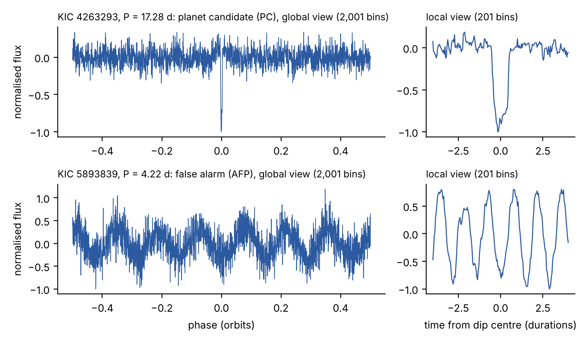
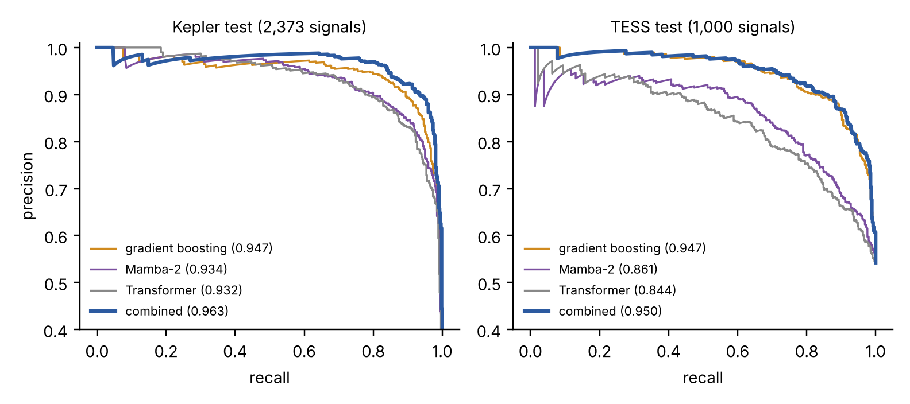
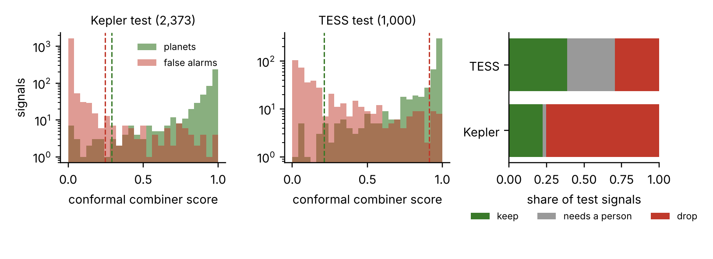
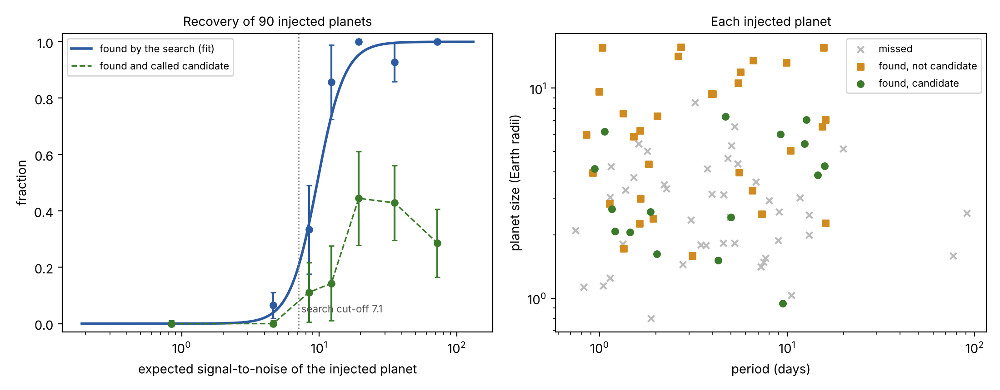
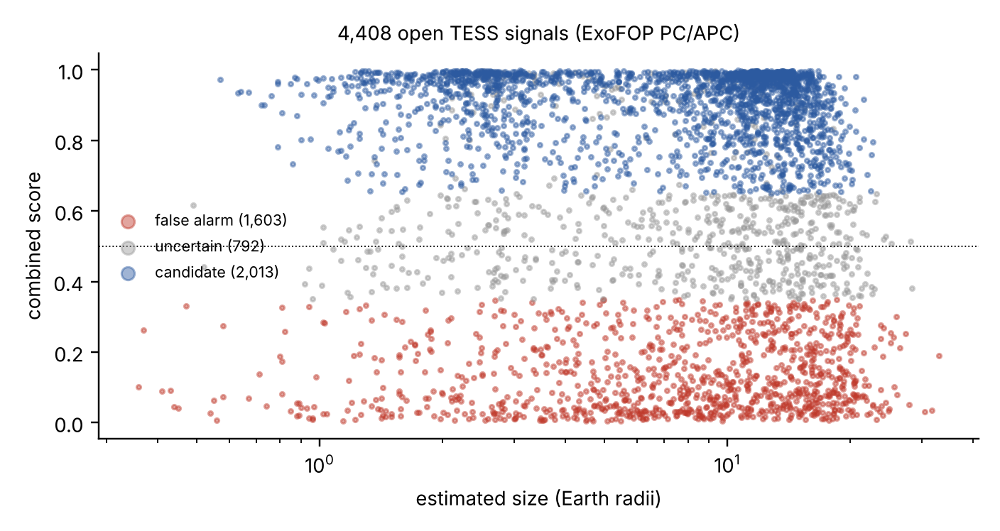
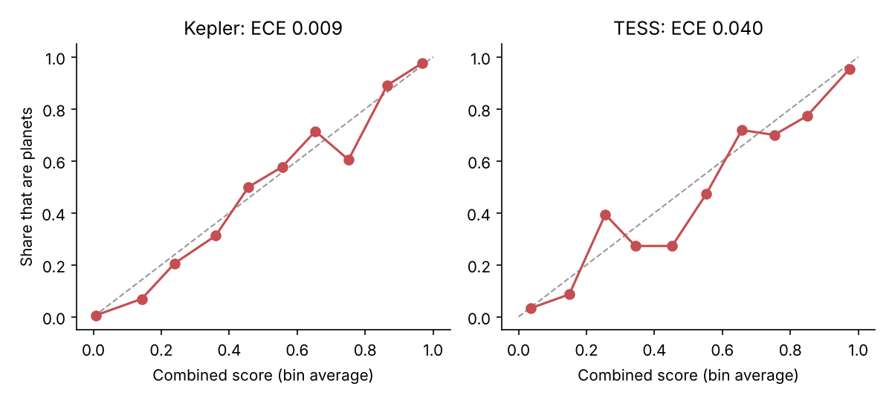
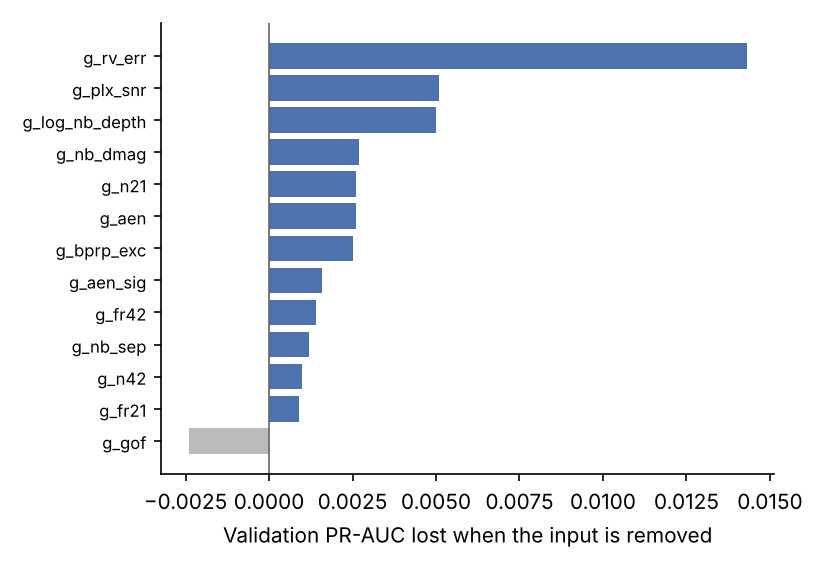
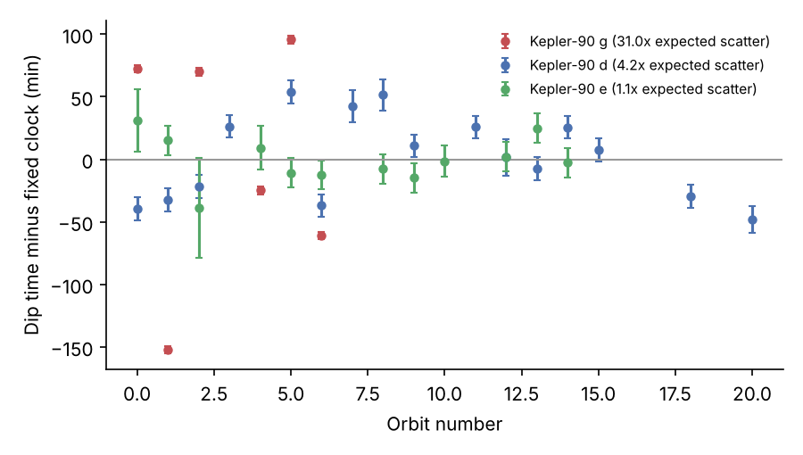

# Abstract

Transit surveys find far more periodic dips than people can check by hand, and most are not planets. We present TransitVet, an open pipeline that takes a Kepler or TESS light curve, searches it for repeating dips, and gives each signal a calibrated score and a three-way call (keep, drop, or needs a person). We first reproduce the AstroNet convolutional network on Kepler DR24 (accuracy 0.955, ROC-AUC 0.989 under its split by signal) and show that a split by star gives lower numbers. Under one protocol (split by star, every choice made on validation stars, test stars used once) we compare a threshold rule, gradient boosting on vetting statistics, AstroNet, a pretrained patch Transformer and a Mamba-2 state-space model. The released tool combines gradient boosting, Mamba-2 and the Transformer through a logistic combiner. On held-out stars it reaches a precision-recall AUC of 0.963 on Kepler (2,373 signals) and 0.950 on TESS (1,000 signals). On 542 TESS test signals also scored by ExoMiner++, the two are within the uncertainty (0.968 and 0.973). Class-conditional split conformal prediction keeps at least 95 per cent coverage for both classes on test stars. An injection-recovery test with 90 synthetic planets shows the search recovers half of them at an expected signal-to-noise ratio of about 10. It also shows that the call on a recovered planet depends strongly on the host star. We release the code, a web dashboard and scores for 4,408 TESS objects of interest that are still open.

**Keywords:** planets and satellites: detection; methods: data analysis; methods: statistical; techniques: photometric; software: public release [CHECK against the journal's keyword list]

# 1 Introduction

Space photometry missions measure the brightness of hundreds of thousands of stars and search the light curves for small periodic dips. Kepler (Borucki et al. 2010) and TESS (Ricker et al. 2015) have produced tens of thousands of such threshold-crossing events, but only a minority are planets. The rest are eclipsing binaries, light from a nearby eclipsing star that falls in the same pixels, stellar variability, or instrumental noise. Deciding which signals deserve follow-up is called vetting. By hand it is slow, and the catalogues show that people do not always agree.

Machine learning has become a standard aid for vetting. AstroNet (Shallue & Vanderburg 2018) showed that a one-dimensional convolutional network on phase-folded light curves ranks Kepler planet candidates above false positives with high accuracy. Later work moved this to TESS (Yu et al. 2019; Tey et al. 2023), added more diagnostic inputs (ExoMiner, Valizadegan et al. 2022; ExoMiner++, Valizadegan et al. 2025), and tried attention-based models (Salinas et al. 2023). Two practical questions remain less explored in the papers we read. First, how much do reported numbers depend on how the data are split? Second, how should a tool show its uncertainty, when a confident wrong answer costs telescope time?

This paper describes TransitVet, a light pipeline that runs from a downloaded light curve to a scored list of signals, and the evaluation behind it. Our contributions are:

1. **A reproduction of AstroNet** on Kepler DR24, with its original split by signal and with a stricter split by star (Section 5.1).
2. **One evaluation protocol** under which a rule, gradient boosting, AstroNet, a pretrained Transformer and a Mamba-2 model are compared on Kepler and TESS. The protocol splits by star, makes every choice on validation stars and uses test stars once (Sections 4 and 5).
3. **A combined score with a coverage check.** Class-conditional split conformal prediction sends signals the models cannot place to a person instead of guessing (Sections 3.6 and 5.5).
4. **Context inputs for TESS** from Gaia DR2 and the TESS Input Catalog, and a difference-image check (Sections 3.4 and 5.4).
5. **An injection-recovery test of the whole pipeline**, which measures both what the search finds and what the classifier then calls it (Section 6).
6. **An open tool**: a web dashboard, a command-line batch mode, and scores for 4,408 TESS objects of interest (TOIs) that are still open, with a frozen forward test against future dispositions (Section 7).

We make no claim of planet discoveries. Every positive output is a planet candidate. Conformal prediction has been applied to transit detection before (ExoVeil; Priyanshu 2026), so we make no priority claim for it.

# 2 Related work

**Convolutional vetting on folded views.** Shallue & Vanderburg (2018) introduced the global (whole orbit) and local (around the dip) views and a convolutional network trained on the Kepler DR24 autovetter training set. The same idea was adapted to K2 (Dattilo et al. 2019) and to TESS. On TESS, Yu et al. (2019) built a triage and vetting network for the Quick-Look Pipeline, and Tey et al. (2023) improved it, reporting a PR-AUC of 0.965 on full-frame-image signals. These models see only the light curve.

**Models that add diagnostics.** ExoMiner (Valizadegan et al. 2022) feeds the network the same diagnostics a human vetter uses: odd and even transits, secondary eclipses, centroid motion and difference images. It was used to validate 301 Kepler planets. ExoMiner++ (Valizadegan et al. 2025) extends this to TESS 2-minute data with transfer learning from Kepler, and publishes scores for all TESS SPOC signals. Our gradient-boosting model follows the same idea with a smaller set of hand-built statistics. ExoMiner++ is the main external comparison in Section 5.6.

**Attention and state-space models.** Transformers have been applied to TESS vetting (Salinas et al. 2023). Masked-patch pretraining, borrowed from vision and language models, lets a Transformer learn from unlabelled light curves. Mamba-2 (Dao & Gu 2024) is a selective state-space model that scales linearly with sequence length. It has, to our knowledge, seen little use on folded light curves [CHECK]. We test both under the same inputs as AstroNet.

**Calibration and uncertainty.** A vetting score is most useful when a score of 0.8 means that about 8 in 10 such signals are planets. Isotonic regression and temperature scaling are standard fixes for a model that is too confident. Conformal prediction (Vovk et al. 2005; Lei et al. 2018) gives prediction sets with a coverage guarantee that does not depend on the model. ExoVeil (Priyanshu 2026) uses conformal prediction to rank transit detections from a learned model of stellar behaviour. We use the class-conditional (Mondrian) form to give a per-class guarantee for vetting.

**Search sensitivity.** Injection-recovery tests are the standard way to measure a transit search's completeness. Most vetting papers report classifier metrics on catalogue signals. We run injections through the full pipeline (search, checks and classifier) because a planet that is found but then called a false alarm is still lost to the user.

# 3 Data and pipeline

## 3.1 Data and labels

Table 1 lists the data. For Kepler we use the Q1–Q17 DR24 threshold-crossing events and the autovetter training labels used by AstroNet: planet candidate (PC) = 1; astrophysical false positive (AFP) and non-transiting phenomenon (NTP) = 0 (Coughlin et al. 2016). Light curves are the Kepler long-cadence files from MAST. For TESS we use the TOI table (Guerrero et al. 2021), downloaded from the NASA Exoplanet Archive on 1 November 2026, and the SPOC 2-minute light curves. Confirmed (CP) and known (KP) planets are labelled 1; false positives (FP) and false alarms (FA) are labelled 0. Planet candidates (PC) and ambiguous planet candidates (APC) have no final label. We use them for pretraining (without labels) and score them in Section 7.

**Table 1.** Data sets. Splits are by star: all signals of a star go to the same part.

| Set | Signals | Stars | Labels | Split (train / validation / test signals) |
|---|---|---|---|---|
| Kepler DR24 | 15,737 | 9,865 | PC = 1; AFP, NTP = 0 | 70/15/15 by star: 11,053 / 2,311 / 2,373 |
| TESS labelled TOIs | 2,502 | 2,357 | CP, KP = 1 (1,388); FP, FA = 0 (1,114) | 50/10/40 by star: 1,243 / 259 / 1,000 |
| TESS open TOIs | 4,408 | 4,294 | none (3,964 PC, 439 APC, 5 blank) | scored only |

All 6,910 TOIs with SPOC 2-minute data, on 6,611 stars, were processed with no failures. The Kepler test set holds 519 planet candidates and 1,854 false signals on 1,480 stars. The TESS test set holds 542 planets and 458 false signals on 943 stars, so a random score would reach a PR-AUC of 0.54 there. The TESS split gives the test set a larger share than usual (40 per cent) so that TESS results have usable error bars.

## 3.2 Light-curve preparation and search

Figure 1 shows the pipeline.

{width=100%}

1. **Cleaning.** We keep points with quality flag 0. TESS sectors are binned to 30 minutes before detrending, so Kepler and TESS views have similar sampling.
2. **Detrending.** For the search, a time-windowed biweight filter (wōtan; Hippke et al. 2019) with a 1-day window. Upward outliers above 5 robust standard deviations are removed; dips are kept. For the folded views, the piecewise spline of AstroNet, so that our views match its inputs.
3. **Search.** Box least squares (BLS; Kovács et al. 2002) from 0.6 d to a third of the data span (at most 500 d). A signal needs a BLS signal-to-noise ratio of at least 7.1. Up to five signals are kept per star, and each is masked before the next search. If every second dip is empty, the period is doubled.
4. **Folded views.** As in AstroNet: a global view of 2,001 bins over the whole orbit and a local view of 201 bins spanning ±4 transit durations (Figure 2).

{width=100%}

## 3.3 Vetting statistics

From the detrended light curve we compute ten statistics that a human vetter would look at:

- dip depth and signal-to-noise ratio
- odd/even depth difference, in standard deviations
- depth and significance of a dip at half an orbit (secondary eclipse)
- a shape ratio separating U-shaped from V-shaped dips
- number of dips seen
- period and duration
- coverage of the local view

Heavy-tailed statistics are passed through a signed logarithm. A further check measures whether each single dip looks like the median dip (Section 3.7).

## 3.4 Star and pixel context

- **TESS Input Catalog.** We take the star radius and the contamination ratio (light from neighbours) from the TESS Input Catalog v8.2. The planet size is estimated from the depth and the star radius.
- **Light-position check.** The flux-weighted centroid shift during the dip is measured, and its significance and implied source offset are used as inputs. Its formal significance is inflated by correlated noise (median about 7 sigma even for Kepler planet candidates). The models learn its real scale, but user warnings use thresholds set on training signals (Kepler: shift above 10 sigma and source more than 30 arcsec away).
- **Gaia DR2 (TESS only).** For each TESS host we query Gaia DR2 (Gaia Collaboration 2018) at MAST within 60 arcsec. The TIC position is first moved to the Gaia epoch (2015.5) with the star's proper motion. The target is the brightest Gaia source within 3 arcsec, or within 10 arcsec for fast-moving stars. 7,815 of the 7,826 TOI hosts matched. Thirteen numbers enter the TESS model:
  - the star's astrometric excess noise and its significance, fit quality, radial-velocity error, BP/RP colour excess and parallax signal-to-noise
  - the number of Gaia sources within 21 and 42 arcsec (one and two TESS pixels) and the light they add
  - the magnitude difference and distance of the brightest neighbour
  - the dip depth the brightest neighbour would need to fake the signal (log scale)

  We use DR2 because MAST serves it; it has no RUWE column, so excess noise stands in for it.
- **Difference images (TESS).** For each sector we form the out-of-dip minus in-dip image from the target pixel file and fit a two-dimensional Gaussian to it. Noise is measured at fake dip times between the real ones. The offsets are combined across sectors (at most two per star). This follows the idea of the pipeline difference-image centroid test, but uses a Gaussian instead of the instrument's real point-spread model. It is used as a verdict rule, not as a score input (Section 5.4).

## 3.5 Models

**Table 2.** The models. All neural models read the same two views. Settings were chosen on validation stars only.

| Model | Input | Settings |
|---|---|---|
| Threshold rule | depth, SNR, odd/even | three limits by grid search on training stars |
| Gradient boosting (GB) | vetting statistics, star and pixel context (+ Gaia on TESS) | histogram GB (scikit-learn), up to 500 iterations, learning rate 0.05, early stopping; 5 seeds averaged |
| AstroNet CNN | both views | as Shallue & Vanderburg (2018): 9.9 M parameters, Adam 2×10⁻⁴, batch 256; checkpoint chosen on validation PR-AUC |
| Patch Transformer | 63 global patches of 32 bins + 26 local patches of 8 bins | 4 layers, width 128, 4 heads, pre-norm, 0.55 M parameters; pretraining AdamW 3×10⁻⁴, fine-tuning AdamW 10⁻⁴, both with a one-cycle schedule |
| Mamba-2 | the same 89 patches | 4 bidirectional Mamba-2 blocks in the state-space-duality form, width 64, state 32, dropout 0.2, weight decay 0.1, time-flip and noise augmentation; AdamW 10⁻³ |

**Pretraining.** The Transformer is pretrained by masking 40 per cent of patches and reconstructing them (mean squared error). This uses 15,456 views without labels: the 11,053 Kepler training signals and 4,403 open TESS TOIs. No validation or test star is used.

**TESS training.** The neural models are trained on Kepler and fine-tuned on TESS training stars. GB is trained on TESS training stars directly.

**Mamba-2 implementation.** We wrote Mamba-2 in plain PyTorch using its matrix ("state-space duality") form. It matches the step-by-step recurrence to 1.5×10⁻⁸. Because a folded light curve has no arrow of time, each block runs in both directions.

## 3.6 Combined score and the 95 per cent check

Each model's output is calibrated with isotonic regression on validation stars. The combined score is a logistic regression on the three models' log-odds (GB, Mamba-2 and Transformer), also fitted on validation stars. The fitted weights are 0.54, 0.35 and 0.14 on Kepler, and 0.99, 0.01 and 0.17 on TESS. On TESS the combined score therefore rests almost entirely on gradient boosting.

For the coverage check we split the validation stars in two halves by star. Half A fits a second combiner; half B (1,157 Kepler and 129 TESS signals) calibrates it. With class-conditional (Mondrian) split conformal prediction at α = 0.05, we set two cut-offs, one per class, from the calibration scores. For a new signal, "planet" stays in the prediction set if its nonconformity score is below the planet cut-off, and likewise for "false alarm". If only planet remains, the call is **keep**. If only false alarm remains, the call is **drop**. If both or neither remain, the signal goes to a person. If new signals are exchangeable with the calibration signals, at least 95 per cent of real planets keep "planet" in their set, and at least 95 per cent of false alarms keep "false alarm". The check is a statement about each class, not about the share of keep calls that are planets. In the tool, a signal also goes to a person when the conformal call and the combined score point different ways (keep with a score below 0.5, or drop with a score of 0.5 or more).

## 3.7 Verdict rules

The verdict is **candidate** if the combined score is at least 0.5 and **false alarm** otherwise. It becomes **uncertain** in any of these cases:

- the score is between 0.35 and 0.65
- all three single models disagree with it
- fewer than 3 dips are seen
- a second, separate dip appears at the same period
- the difference image points to a neighbour
- for signals with 6 dips or fewer, fewer than 3 single dips are seen at 3 sigma and within 50 per cent of the median depth ("dips alike")

The last rule was added after we raised the search to five signals per star, which produced long-period signals built from one or two odd events. Its thresholds were fixed before testing.

Two further outputs are display only. A batman transit fit (Kreidberg 2015) gives the period, size ratio and shape. A dip-timing check fits each dip with a trapezoid and uses the timing errors of Carter et al. (2008); it flags timing variations when at least 4 dips are timed, the robust scatter is at least 3 times the errors, and the excess is at least 5 sigma.

# 4 Evaluation protocol

- **Split by star.** All signals from one star go to the same part. Signals on the same star share noise, systematics and often the same astrophysics (for example, both eclipses of a binary). A split by signal lets a model learn the star rather than the signal.
- **Validation only.** Every choice uses validation stars only: hyperparameters, checkpoints, calibrators, combiner weights, conformal cut-offs and verdict thresholds. Test stars were scored once, at the end.
- **Seeds.** Neural models were trained with 5 seeds (3 for ablations and label-fraction runs). We report the mean ± standard deviation of single models and the score of the 5-model average.
- **Metrics.** The main metric is the area under the precision-recall curve (PR-AUC, average precision). It is more informative than ROC-AUC when classes are unbalanced, as on Kepler, where 22 per cent of test signals are planet candidates. We also report counts at the tool's own rule (score ≥ 0.5), calibration error (ECE, 15 equal-width bins) and conformal coverage.
- **Uncertainty.** Uncertainty on PR-AUC and on differences comes from 2,000 bootstrap resamples of test stars, not of signals.

# 5 Results

## 5.1 Reproducing AstroNet

Under AstroNet's own split by signal (random seed 123; test 1,574 signals), our PyTorch reproduction with 10 models reaches accuracy 0.955 and ROC-AUC 0.989 (average of 10 models). The original paper reports 0.960 and 0.988. The mean single model reaches 0.951 ± 0.004 and 0.987 ± 0.001. Under a split by star with the same proportions (80/10/10; test 1,576 signals), the 10-model average gives accuracy 0.951, ROC-AUC 0.982 and PR-AUC 0.943, against PR-AUC 0.948 under the split by signal. The two test sets differ, so the gap is not a paired comparison. It is, however, in the direction expected if a split by signal leaks information through shared stars.

## 5.2 Kepler

**Table 3.** Kepler test (2,373 signals, split by star 70/15/15). Mean ± s.d. over seeds; the last column is the 5-model average where one exists.

| Model | PR-AUC | ROC-AUC | 5-model average PR-AUC |
|---|---|---|---|
| Threshold rule | 0.463 | 0.815 | |
| GB, light-curve statistics only | 0.885 ± 0.005 | 0.972 ± 0.001 | |
| Transformer, no pretraining | 0.923 ± 0.002 | 0.976 ± 0.001 | 0.930 |
| Mamba-2 | 0.926 ± 0.004 | | 0.934 |
| Transformer, pretrained | 0.931 ± 0.002 | 0.979 ± 0.001 | 0.932 |
| AstroNet CNN | 0.941 ± 0.003 | 0.984 ± 0.001 | 0.947 |
| GB with star and pixel context | | 0.986 | 0.947 (5 seeds averaged) |
| **Combined (GB + Mamba-2 + Transformer)** | | **0.991** | **0.963** (95% interval 0.945–0.980) |

A frozen time-series foundation model (MOMENT-1-small) with a logistic probe reached 0.918 and added nothing to the combined score. Replacing Mamba-2 with the AstroNet CNN in the combiner gives 0.968. The difference is within the bootstrap uncertainty, and we ship the Mamba-2 version. At the 0.5 rule, the combined score rejects 1,804 of 1,854 false signals and keeps 482 of 519 planet candidates. Figure 3 shows the precision-recall curves.

{width=100%}

**Ablations (Table A1).** For the CNN, the global view alone loses 0.019 PR-AUC and the local view alone loses 0.056. Replacing AstroNet's spline with our biweight detrending changes PR-AUC by +0.004. For GB on light-curve statistics, the dip shape matters most: removing it costs 0.060. Next come period and duration (0.033), the secondary eclipse (0.024) and depth and SNR (0.017). The odd/even statistic adds nothing measurable. Adding the context inputs (light position, planet size, contamination) raises GB from 0.885 to 0.947. Leaving out the planet size alone costs 0.011.

**Pretraining with few labels (Table 4).** Masked-patch pretraining helps the Transformer most when labels are scarce.

**Table 4.** Kepler test PR-AUC against the share of labelled training stars (3 seeds; 5 at 100 per cent).

| Labels used | Training signals | Transformer, pretrained | Transformer, no pretraining | Gain | AstroNet CNN |
|---|---|---|---|---|---|
| 10% | 1,111 | 0.855 ± 0.008 | 0.830 ± 0.013 | +0.026 | 0.899 ± 0.023 |
| 25% | 2,761 | 0.900 ± 0.003 | 0.900 ± 0.003 | +0.001 | 0.921 ± 0.011 |
| 50% | 5,523 | 0.923 ± 0.005 | 0.914 ± 0.003 | +0.010 | 0.933 ± 0.001 |
| 100% | 11,053 | 0.931 ± 0.002 | 0.923 ± 0.002 | +0.007 | 0.941 ± 0.003 |

At every label fraction the CNN stays ahead of both Transformers. At this data size (about 11,000 training signals), neither attention nor a state-space model beats the convolutional baseline on Kepler views.

## 5.3 TESS and transfer from Kepler

**Table 5.** TESS test PR-AUC (1,000 signals; random = 0.542). Mean ± s.d. over 5 seeds.

| Model | Kepler-trained, unchanged | Fine-tuned on TESS | TESS only |
|---|---|---|---|
| GB, light-curve statistics | 0.800 ± 0.005 | | 0.876 ± 0.006 |
| AstroNet CNN | 0.835 ± 0.005 | 0.858 ± 0.006 | 0.822 ± 0.009 |
| Transformer, pretrained | 0.819 ± 0.003 | 0.842 ± 0.002 | 0.795 ± 0.013 |
| Mamba-2 | 0.840 | 0.852 | 0.808 |

For the neural models, pretraining on Kepler and fine-tuning on TESS beats training on TESS alone. This is expected with only 1,243 TESS training signals. Models used unchanged from Kepler are poorly calibrated on TESS: ECE is 0.146 for the CNN and 0.182 for the Transformer. Isotonic calibration on TESS validation stars brings this to 0.058 and 0.060 (Table A2). In-mission Kepler calibration is already good (ECE 0.018 and 0.022).

The tool's TESS models are the fine-tuned networks (5-model averages: Mamba-2 0.861, Transformer 0.844) and GB with context inputs. Light-curve statistics plus star context carry most of the TESS performance. Planet size and contamination alone lift GB from 0.883 to 0.940. The light-position check helps less on TESS (to 0.890 on its own), because TESS pixels are 21 arcsec wide. The combined score reaches 0.946 without Gaia.

## 5.4 Gaia context and difference images on TESS

Adding the 13 Gaia numbers to GB raises its TESS test PR-AUC from 0.940 to 0.947, and the combined score from 0.946 to 0.950 (95 per cent interval 0.933–0.964). The gain of the combined score is +0.004, with a bootstrap interval over stars of −0.008 to +0.016, so it is likely but not proven. The effect is clearer at the 0.5 rule and in the coverage check:

- False signals rejected rise from 363 to 382 of 458, while planets kept go from 492 to 493 of 542.
- Signals sent to a person at the 95 per cent level fall from 508 to 318 of 1,000.

Dropping one Gaia number at a time on validation stars shows the radial-velocity error matters most (0.014 PR-AUC), followed by the neighbour-depth test and parallax signal-to-noise (0.005 each). Radial-velocity errors exist only for stars brighter than about G = 13, so about half the stars lack this input. Gradient boosting handles missing values natively.

The difference-image check could be measured for 69 per cent of TESS test signals. With a threshold chosen on validation stars (offset above 5 sigma and more than 10 arcsec), it flags 19 of 542 test planets (3.5 per cent) and 113 of 458 false signals (24.7 per cent). Used as a score input it did not change PR-AUC, so we use it as a verdict rule. A flagged candidate becomes uncertain. That moved 17 of the 82 false signals the combined score had called candidates, at the cost of 18 planets moved to uncertain. These figures were measured with the tool version before Gaia was added [CHECK: re-run with v4].

## 5.5 The 95 per cent check

**Table 6.** Class-conditional split conformal prediction at α = 0.05 on test stars. Coverage is that of the conformal sets. The keep, drop and person counts are the tool's calls, which also send score/check disagreements to a person.

| Mission (test signals) | Planets with "planet" in set | False signals with "false alarm" in set | Keep | Drop | Needs a person | Planets dropped |
|---|---|---|---|---|---|---|
| Kepler (2,373) | 95.8% | 95.3% | 532 | 1,786 | 55 | 19 |
| TESS (1,000) | 98.0% | 96.3% | 387 | 295 | 318 | 11 |

Coverage meets the 95 per cent target for both classes on both missions (Figure 4). With the disagreement rule, 96.3 per cent of Kepler planets avoid a drop call and 97.3 per cent of Kepler false signals avoid a keep call. Without it, the conformal sets alone give 569 keep and 18 person calls on Kepler; on TESS the rule changes nothing. On Kepler the classes are well separated, so almost every signal gets a firm call. Of the keep calls, 90.6 per cent are planet candidates; of the drop calls, 98.9 per cent are false. On TESS, about a third of signals go to a person. With 129 calibration signals the cut-offs are noisy, and the classes overlap more. We think this is the honest outcome: the tool says when it cannot separate a signal rather than giving a confident score it cannot back up. Of the TESS keep calls, 95.6 per cent are planets.

{width=100%}

## 5.6 Comparison with ExoMiner++

ExoMiner++ publishes out-of-fold scores for TESS SPOC 2-minute signals from sectors 1–67. We matched our TESS test signals by TIC number and period (within 1 per cent). 542 of the 1,000 matched: 347 planets and 195 false signals. The rest were not detected by the SPOC 2-minute pipeline in those sectors. On these 542 signals, TransitVet reaches a PR-AUC of 0.968 and ExoMiner++ 0.973. The difference is −0.005, with a bootstrap interval over stars of −0.019 to +0.010. The average of the two scores reaches 0.982. This average was examined on the test set, so we treat it as a finding to confirm, not a tuned result.

The comparison is not like for like. ExoMiner++ uses SPOC data-validation products, including difference images, and its own training set. TransitVet starts from light-curve files and catalogues, and also scores dips found by its own search and Kepler stars. Whether the ExoMiner++ folds are split by star is not stated in the material we used [CHECK].

## 5.7 Errors, attention and speed

- **Errors.** On the Kepler test set, the CNN's 75 false positives are mostly clean, single, planet-like dips (inspected by eye for the 6 most confident). They were probably rejected for information it does not see, such as centroid motion. This is the gap the context inputs close.
- **Attention.** In the last layer, the pretrained Transformer puts 21 per cent of its attention on the local view for planet candidates, against 38 per cent for false positives. Attention maps show where a model looks, not why it decides.
- **Speed.** On four CPU cores, per-signal inference takes 7 µs for GB, 0.68 ms for the Transformer and 1.37 ms for the CNN. A whole-star run is dominated by download, detrending and the BLS search: about 2.5 minutes per TESS star and 6.6 minutes per Kepler star on one core (medians from a 50-star end-to-end test with an earlier tool version).

# 6 Injection-recovery test

We added 125 synthetic planets to the raw light curves of 19 held-out test stars and ran the whole pipeline unchanged. The planets used a batman model with quadratic limb darkening, a circular orbit and an impact parameter from 0 to 0.8. The pipeline covered the search, checks, Gaia inputs, models, verdict and coverage check; the difference-image check was off to save time. Periods were drawn log-uniformly from 0.7 d to a third of the data span (at most 200 d). For 110 of the planets, the size was set so that the expected signal-to-noise ratio was drawn log-uniformly between 3 and 80. The expected ratio is the depth divided by the robust scatter of the flattened curve, times the square root of the number of in-transit points. The other 15 planets came from a first round with sizes drawn log-uniformly from 0.7 to 8 Earth radii. A synthetic planet counts as recovered when a signal matches its period (or half or double) within 1 per cent and its time of dip.

We left out 31 planets with fewer than 3 dips in the data, which the search cannot find by design. We also left out 4 planets on a giant star (60 solar radii), where the injected depth corresponds to a star-sized companion and a false-alarm call is correct. That leaves 90 planets on 18 stars: 88 on 17 TESS stars and 2 on one Kepler star. Kepler runs took about 17 minutes each.

**Table 7.** Recovery against expected signal-to-noise ratio.

| Expected SNR | Planets | Recovered | Recovered and called candidate |
|---|---|---|---|
| below 3 | 6 | 0 | 0 |
| 3–7.1 | 31 | 2 | 0 |
| 7.1–10 | 9 | 3 | 1 |
| 10–15 | 7 | 6 | 1 |
| 15–25 | 9 | 9 | 4 |
| 25–50 | 14 | 13 | 6 |
| 50 and above | 14 | 14 | 4 |

A logistic fit in log signal-to-noise gives 50 per cent recovery at an expected ratio of about 10 and 90 per cent at about 16 (Figure 5). Above 15, 36 of 37 planets were recovered. The search's own cut-off is 7.1.

{width=100%}

What a recovered planet was then called depends strongly on the host star:

- On 7 stars whose own TOI is a confirmed or known planet, 13 of 20 recovered planets were called candidates. Two more were uncertain, 4 were called false alarms, and the coverage check said keep for 14.
- On 10 stars whose own TOI is a false positive, only 3 of 27 were called candidates. Six were uncertain, 18 were called false alarms, and the coverage check said keep for 1.

We re-ran four of these cases with and without the Gaia inputs. All three models scored the injected planets low, not only the GB model that reads Gaia, and removing Gaia made the score lower, not higher. Several of these hosts are hot stars (about 7,000 to 10,000 K). There, pulsation and other eclipses may make any folded dip look less like a planet, but we have not verified this [CHECK]. One possible reading is that the models have learned that some kinds of stars rarely host planets.

This is a real limit. A planet around such a star may be missed by the score even when the search finds it. By size, 9 of 20 recovered planets under 4 Earth radii were called candidates, 7 of 19 between 4 and 10, and 0 of 8 between 10 and 16. The test is small (90 planets, 18 stars), and the curve is poorly constrained between signal-to-noise 7 and 15.

For each analysed star, the dashboard turns this curve into the chance that the search would recover planets of 1, 2 and 4 Earth radii at periods of 3, 10 and 30 days. The calculation uses the star's own scatter and number of points. Its signal-to-noise estimate matches the one measured in the injection runs (median ratio 0.99, 10th to 90th percentile 0.95 to 1.10, 17 checks). The host-star caveat is shown next to it.

# 7 Open TESS signals and a forward test

We scored all 4,408 TOIs that were still open on 1 November 2026 (Figure 6):

- 1,304 are strong candidates (score at least 0.5, at least 3 dips, coverage check keep). Of these, 398 have an estimated size under 4 Earth radii.
- 1,603 look like false alarms.
- 1,988 go to a person.

As a consistency check, 66 per cent of APC signals and 33 per cent of PC signals come out as false alarms. ExoMiner++ also scores 2,502 of these signals. The two place 72 per cent on the same side of 0.5, with a Spearman correlation of 0.59. The list is meant for planning follow-up and is released as a table.

{width=100%}

To test the tool on labels no model could have seen, we froze these calls on 17 November 2026. A scheduled script compares them each week with NASA's latest TOI table and publishes the tally. At the time of writing, 6 of the open TOIs have been resolved. Of the 5 we scored at 0.5 or above, 4 became planets and 1 a false positive; the 1 we scored below 0.5 became a false positive. This sample is far too small to judge. It is the start of a test that will grow over the coming months.

**Dips alike.** We tested the "dips alike" rule (Section 3.7) on 271 held-out signals with 6 dips or fewer, using the dashboard's own loader. On Kepler it moved none of 9 candidate planets. On TESS it moved 11 of 22 candidate false signals and 15 of 69 candidate planets to uncertain. That raised the share of planets among TESS few-dip candidates from 76 to 83 per cent.

# 8 The tool

TransitVet is released under the MIT licence. A Streamlit dashboard takes a KIC or TIC number, downloads the light curve, and runs the pipeline with a step-by-step view. It returns a plain-language summary and a report card for each signal (score, verdict, coverage-check call, and the checks behind them). It also shows:

- a top-down sketch of the system
- each dip played as sound, for accessibility
- the detection chance (Section 6)
- the next observable dips for a user's site and telescope
- the ExoMiner++ score as a second opinion where one exists

A batch mode writes the same results for many stars. Repeat runs of a star are served from a cache. The code has 43 automated tests, and the repository includes all validation scripts and notes.

# 9 Discussion and limits

- **Labels share our checks.** Official dispositions were made partly with the same kinds of evidence our context inputs use: centroid shifts, difference images and planet size. Part of the gain from these inputs therefore measures agreement with the official vetting rather than independent evidence. That agreement is what a vetting aid is for, but it is not independent proof.
- **TESS is small.** With 2,502 labelled TESS signals, TESS results carry wide intervals. The conformal cut-offs rest on 129 calibration signals.
- **One model does most of the work on TESS.** The TESS combiner gives Mamba-2 a weight of 0.01. On TESS our result rests mainly on gradient boosting with context inputs, and the neural models add little there.
- **Modern architectures did not beat the CNN at this data size.** Mamba-2 matched the pretrained Transformer on Kepler, and a frozen foundation model was below every trained model. We ship Mamba-2 for its smaller size and equal combined performance, not because it is better on its own.
- **Search limits.** The search needs three dips and does not search periods below 0.6 d. It misses Kepler-910 b (0.82 Earth radii, 2.36 d) for a reason we have not yet traced.
- **Host-star effect.** Section 6 shows that a recovered planet on a star whose own signal is a false positive is usually not called a candidate. Users should read a false-alarm call on such a star with care.
- **Gaia DR2 and pixel scale.** DR3 and RUWE may serve better than DR2. The light-position and difference-image checks cannot resolve neighbours closer than about one pixel (4 arcsec on Kepler, 21 arcsec on TESS).
- **Timing flags.** On Kepler-90, the dip-timing check flags planet d (scatter 4.2 times the expected errors). Published timing work on Kepler-90 covers the outer planets g and h (Cabrera et al. 2014; Liang et al. 2021). We found no published timing variation for d, so we treat this flag as unconfirmed.

# 10 Conclusions

Under one honest protocol (split by star, choices on validation stars, test stars used once), a light, open pipeline reaches a PR-AUC of 0.963 on Kepler and 0.950 on TESS. That puts it within the uncertainty of ExoMiner++ on shared TESS signals. A class-conditional conformal check holds its 95 per cent coverage on test stars and tells users which signals it cannot place. An injection-recovery test of the whole pipeline measures what the search can find and exposes a host-star effect in what the classifier then calls it. The tool, the scores for 4,408 open TESS signals and the frozen forward test are public, so others can check these results and extend them.

# Acknowledgements

This paper includes data collected by the Kepler and TESS missions, obtained from the Mikulski Archive for Space Telescopes (MAST). Funding for the Kepler mission is provided by NASA's Science Mission Directorate; funding for the TESS mission is provided by NASA's Science Mission Directorate. This research has made use of the NASA Exoplanet Archive, operated by the California Institute of Technology under contract with NASA, and of data from the European Space Agency mission Gaia, processed by the Gaia Data Processing and Analysis Consortium. We thank the ExoMiner++ team for publishing their scores. [CHECK the exact acknowledgement wording each archive asks for.]

# Software

Python, NumPy, SciPy, pandas, scikit-learn, PyTorch, Astropy, astroquery, lightkurve, wōtan (Hippke et al. 2019), batman (Kreidberg 2015), Matplotlib and Streamlit. [CHECK versions and add the software citations each package asks for.]

# Data availability

The code, trained models, validation scripts, the scores for the 4,408 open TESS signals and the weekly forward-test tally are available at https://github.com/Girinath11/transitvet. The web dashboard is at https://transitvet.streamlit.app and the project website at https://girinath11.github.io/transitvet. Kepler and TESS light curves are available from MAST, the label tables from the NASA Exoplanet Archive, and Gaia DR2 from the Gaia archive and MAST. [Consider a Zenodo archive with a DOI for the release.]

# References

- Borucki W. J., et al., 2010, Science, 327, 977 [CHECK]
- Cabrera J., et al., 2014, ApJ, 781, 18
- Carter J. A., Yee J. C., Eastman J., Gaudi B. S., Winn J. N., 2008, ApJ, 689, 499
- Coughlin J. L., et al., 2016, ApJS, 224, 12
- Dao T., Gu A., 2024, in Proc. 41st International Conference on Machine Learning, PMLR 235 (arXiv:2405.21060)
- Dattilo A., et al., 2019, AJ, 157, 169
- Gaia Collaboration, Brown A. G. A., et al., 2018, A&A, 616, A1
- Guerrero N. M., et al., 2021, ApJS, 254, 39
- Hippke M., David T. J., Mulders G. D., Heller R., 2019, AJ, 158, 143
- Kovács G., Zucker S., Mazeh T., 2002, A&A, 391, 369
- Kreidberg L., 2015, PASP, 127, 1161
- Lei J., G'Sell M., Rinaldo A., Tibshirani R. J., Wasserman L., 2018, J. Am. Stat. Assoc., 113, 1094
- Liang Y., Robnik J., Seljak U., 2021, AJ, 161, 202
- Priyanshu P., 2026, arXiv:2606.02778
- Ricker G. R., et al., 2015, J. Astron. Telesc. Instrum. Syst., 1, 014003
- Salinas H., et al., 2023, arXiv:2304.14283 [CHECK author list and journal]
- Shallue C. J., Vanderburg A., 2018, AJ, 155, 94
- Tey E., et al., 2023, AJ, 165, 95
- Valizadegan H., et al., 2022, ApJ, 926, 120
- Valizadegan H., et al., 2025, arXiv:2502.09790 [CHECK journal reference]
- Vovk V., Gammerman A., Shafer G., 2005, Algorithmic Learning in a Random World. Springer, New York
- Yu L., et al., 2019, AJ, 158, 25 [CHECK]

# Appendix A: further tables

**Table A1.** Ablations on Kepler test (PR-AUC; CNN 3 seeds, full model 5; GB 5 seeds).

| Change | PR-AUC | Change |
|---|---|---|
| CNN, both views (full) | 0.941 ± 0.003 | |
| CNN, global view only | 0.922 ± 0.007 | −0.019 |
| CNN, local view only | 0.886 ± 0.005 | −0.056 |
| CNN, biweight instead of spline | 0.945 ± 0.002 | +0.004 |
| GB, all light-curve statistics | 0.885 ± 0.005 | |
| GB without odd/even | 0.885 ± 0.004 | 0.000 |
| GB without secondary eclipse | 0.861 ± 0.002 | −0.024 |
| GB without shape | 0.825 ± 0.005 | −0.060 |
| GB without depth and SNR | 0.868 ± 0.003 | −0.017 |
| GB without period and duration | 0.853 ± 0.005 | −0.033 |

**Table A2.** Calibration (expected calibration error, 15 equal-width bins).

| Model | Data | ECE raw | After temperature | After isotonic |
|---|---|---|---|---|
| AstroNet CNN | Kepler test | 0.018 | 0.013 | 0.011 |
| AstroNet CNN | TESS, Kepler model unchanged | 0.146 | 0.106 | 0.058 |
| AstroNet CNN | TESS, fine-tuned | 0.064 | 0.045 | 0.061 |
| Transformer | Kepler test | 0.022 | 0.019 | 0.011 |
| Transformer | TESS, Kepler model unchanged | 0.182 | 0.092 | 0.060 |
| Transformer | TESS, fine-tuned | 0.066 | 0.038 | 0.054 |

{width=90%}

{width=80%}

{width=80%}
